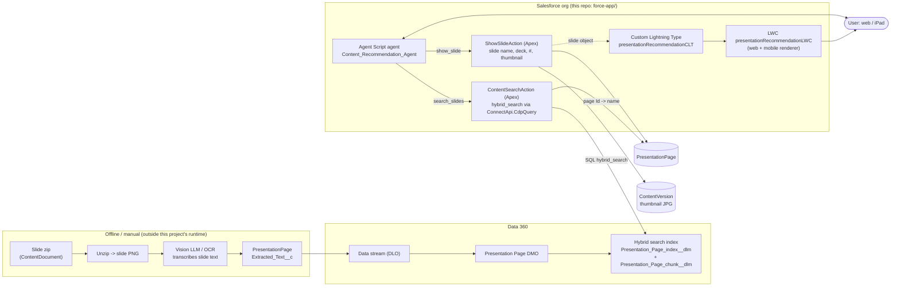
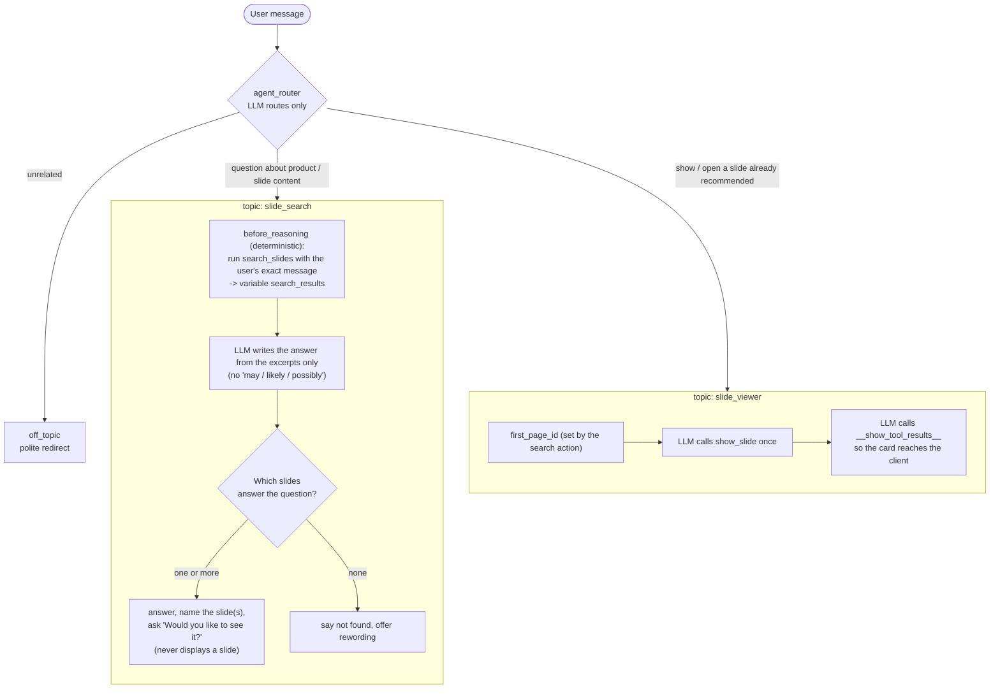
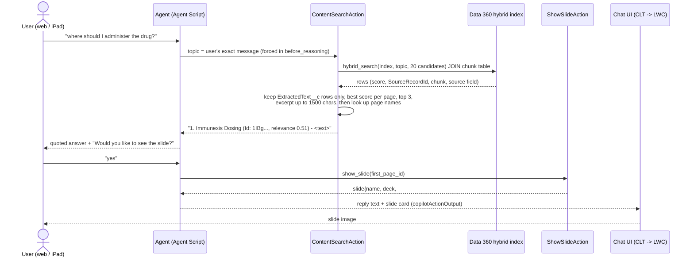

# Content Recommendation Agent

An Agentforce employee agent that answers questions about presentation content by **finding the slide that
contains the answer and showing it inline** (thumbnail card) in the chat, on web and in the iPad (AFLS) app.

> "Where should I administer the drug?" -> quotes *"Administration Sites: Upper arm, thigh, or abdomen"* and shows the
> **Immunexis Dosing** slide.

Slides in this org are images inside zip files, so there is no text for search to index. The solution turns each slide into
text **outside** this system (manual step), indexes that text with Data 360 hybrid search, and uses a thin agent + two Apex
actions to search, answer from the matched text, and render the slide.

## Architecture at a glance



**Key idea:** the search index returns a `PresentationPage` **Id** (`SourceRecordId__c`). That Id is the link back to the
slide: it is what `show_slide` uses to load the name, deck, slide number and thumbnail. This is why we use our own index +
Apex instead of Agentforce Data Library (which grounds on documents, not on slide records, and does not give us a
slide-level link or OCR of text inside images).

## Components

| Piece | Where | Responsibility |
|---|---|---|
| Agent Script | `force-app/main/default/aiAuthoringBundles/Content_Recommendation_Agent/` | Routing, forced search, answer wording, show-slide behavior |
| `ContentSearchAction` | `classes/ContentSearchAction.cls` | Runs `hybrid_search`, ranks, returns top 3 slides with text excerpts |
| `ShowSlideAction` (+ `ShowSlideRequest/Result`) | `classes/` | Looks up the slide and builds the card payload incl. thumbnail |
| `PresentationRecommendationWrapper` | `classes/` | Apex type bound to the Lightning type (`global`, `@JsonAccess`) |
| `presentationRecommendationCLT` | `lightningTypes/` | Custom Lightning Type; desktop and mobile renderers point at the LWC |
| `presentationRecommendationLWC` | `lwc/` | Renders thumbnail + slide name / deck / slide #; web reads `value`, mobile reads `c__*` page-ref state |
| Permission set | `permissionsets/Content_Recommendation_Agent_Access` | Apex class access (and field access for `Extracted_Text__c`) |
| Test harness | `run_agent_tests.py` -> `agent_test_results.md` (generated locally, git-ignored because it contains record Ids) | 18 utterances against the live agent, strict pass/fail |
| Setup notes | `docs/immunexis_hybrid_search_setup.html` | How the slide text and index were built and validated |

## Agent design (`Content_Recommendation_Agent.agent`)



Design decisions and why:

- **The search is forced in code, not requested of the model.** `before_reasoning` runs `search_slides` with
  `@system_variables.user_input` on every turn of `slide_search`. Earlier versions asked the LLM to call the action and it
  intermittently skipped it (answering "I could not find…" without searching).
- **The user's words are passed verbatim.** Shortening or rewriting the query (e.g. injecting "Immunexis") hurt
  relevance: every slide is named "Immunexis …", so name matches swamped the real text match.
- **The LLM judges relevance from excerpts.** Hybrid scores are rank-based, not calibrated (an unrelated question can still
  score ~0.5), so a threshold cannot separate "weak match" from "no match". The model reads the returned text and only
  recommends a slide whose excerpt actually contains the answer.
- **`slide_viewer` is a separate topic** so "show me the first slide" doesn't re-run the search with that sentence and
  overwrite the previous results.
- **Show only on confirmation.** `slide_search` never displays a slide; it answers and asks. "yes / show it" routes to
  `slide_viewer`, which shows the top match (`first_page_id`, returned by `search_slides` as `firstPageId`). This avoids
  loading thumbnails nobody asked for.
- **The card needs two tool calls.** Running `show_slide` from `before_reasoning` (or without the model then calling
  `__show_tool_results__`) returns an empty `result` and no card is rendered. `slide_viewer` therefore tells the model to
  call `show_slide` once, then `__show_tool_results__` once, then stop. A `slide_summary` variable guards the action (`available when slide_summary == ""`, reset in `before_reasoning`); without it the model re-called `show_slide` ~48 times from the second confirmation onward, the prompt grew to 150K+ characters and the iPad stuck on "Loading the slide…".

## Runtime flow



### Search action details (`ContentSearchAction`)

- Query: `hybrid_search(TABLE(Presentation_Page_index__dlm), '<topic>', '', 20)` joined to
  `Presentation_Page_chunk__dlm` on `RecordId__c`; topic is passed through `String.escapeSingleQuotes`.
- **Only `ExtractedText__c` matches count.** Page-name matches are ignored for ranking (names are near-identical, and a
  word like "drug" matches "Drugs comparison"). The slide title is part of the extracted text anyway.
- Floor `MIN_SCORE = 0.2` (just drops noise), top `MAX_RESULTS = 3`, excerpt `abbreviate(1500)` so the full slide text
  reaches the model (a 400-char excerpt cut off the "Storage" line and made the model hedge).
- Returns `matches` (string, one slide per line with Id, relevance and excerpt) and `matchCount`.

### Thumbnail delivery (`ShowSlideAction`)

- Returns an absolute URL `<org domain>/sfc/servlet.shepherd/version/renditionDownload?rendition=THUMB720BY480&versionId=...`.
  A relative URL has no host in the iPad app. A base64 data URI was tried but produced a ~63 KB payload and a ~150K
  character model prompt, so it was dropped.
- Not yet confirmed on the iPad: the image may still need a session cookie or a public ContentDistribution link.

## Data model and indexing (done outside this repo's runtime)

1. Slide image (PNG inside the slide's zip `ContentDocument`) -> transcribed to structured text by a vision LLM
   (macOS Vision OCR was tried first but flattened tables and misread numbers, e.g. 4.1% -> 1%).
2. Text written to `PresentationPage.Extracted_Text__c` (Long Text Area, 32,768). FLS is granted through the permission set.
3. Data stream -> Presentation Page DMO -> hybrid search index. Chunks land in `Presentation_Page_chunk__dlm` with
   `SourceRecordId__c` (the `PresentationPage` Id) and `DataSource__c` (which field matched: `ExtractedText__c` or
   `ssot__Name__c`).

**OCR/transcription is a manual step.** When a presentation is added or changed, its text must be regenerated and loaded
before it becomes searchable. See `docs/immunexis_hybrid_search_setup.html`, `immunexis/build_text.py`.

## Mobile rendering (AFLS iPad)

`presentationRecommendationLWC` supports both data paths: on web the platform sets the `@api value`; in the mobile app the
data arrives as `lightning/navigation` page-reference state params (`c__slideName`, `c__thumbnailUrl`, ...) and is only
accepted when `c__channel === 'Mobile'`. If the thumbnail is blank on iPad, the absolute URL may need authentication the app does not send.

## Deploy and test

```bash
export SFDX_DISABLE_DNS_CHECK=true          # needed if the My Domain DNS check times out
ORG=262-lsdo-july                            # the org that holds the Immunexis content

sf project deploy start -o $ORG -d force-app/main/default/classes          # Apex
sf agent validate authoring-bundle -o $ORG -n Content_Recommendation_Agent
sf agent publish  authoring-bundle -o $ORG -n Content_Recommendation_Agent  # creates a new version (inactive)
sf agent activate -o $ORG -n Content_Recommendation_Agent --version <n>     # make it live

python3 run_agent_tests.py                   # ~10 min; writes agent_test_results.md
```

Notes:
- `sf agent preview` against the *local* authoring bundle fails in the current CLI; the harness tests the published agent.
- Each publish creates a new `BotVersion`; roll back with `sf agent activate --version <older>`.
- API version is 68.0 (`sfdx-project.json`).

### What the tests check (`run_agent_tests.py`)

18 utterances across dosing, efficacy, safety, overview, patient support, multi-turn "show me the first slide", content
not in the deck, no-match and off-topic. A case passes only if the expected action was called in the final turn, the
**expected slide is the first one named (or the one actually shown)**, the reply doesn't hedge (`may`, `likely`,
`possibly`), and search cases ask before showing and never call `show_slide`.

## Known limitations

- **Manual text extraction** (above); search quality depends on the quality of the extracted text.
- **Relevance isn't calibrated**, so "no match" relies on the model reading the excerpts.
- **Only the Immunexis deck is covered by tests.** The org holds other presentations; a statin test slide
  (one of the extra test pages loaded into the org) is not returned and may not be indexed.
- **Slides without extracted text are not findable** (name-only matches are intentionally ignored).
- iPad thumbnail rendering and the earlier iPad hang are unverified on the device.
- The agent answers conversationally, so exact wording varies run to run.
